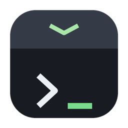
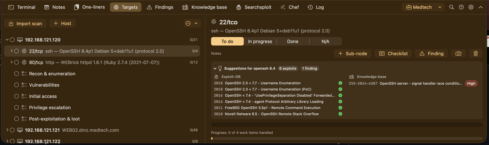
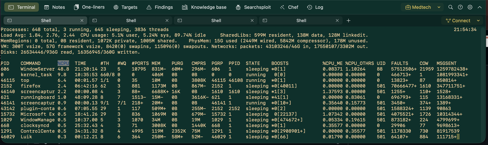
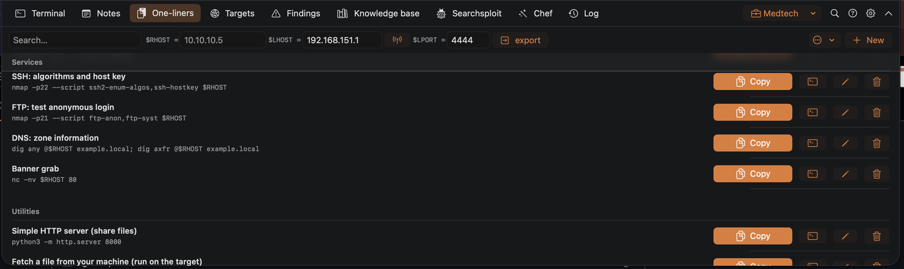
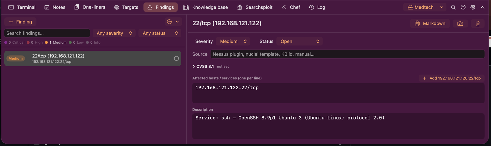
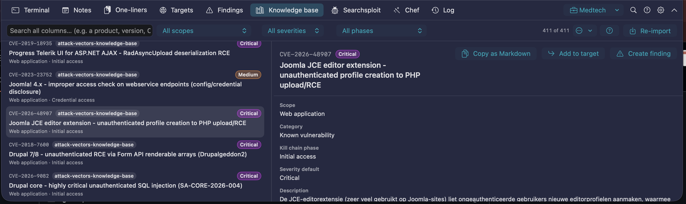
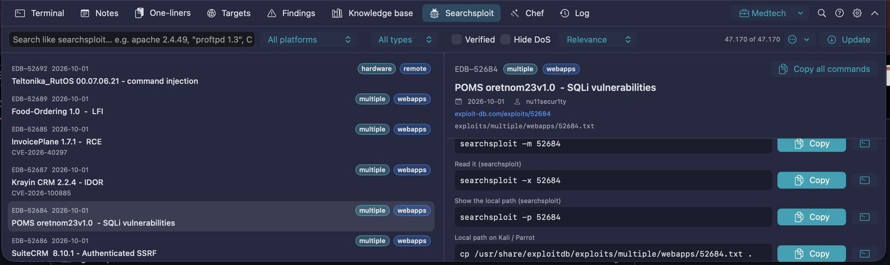
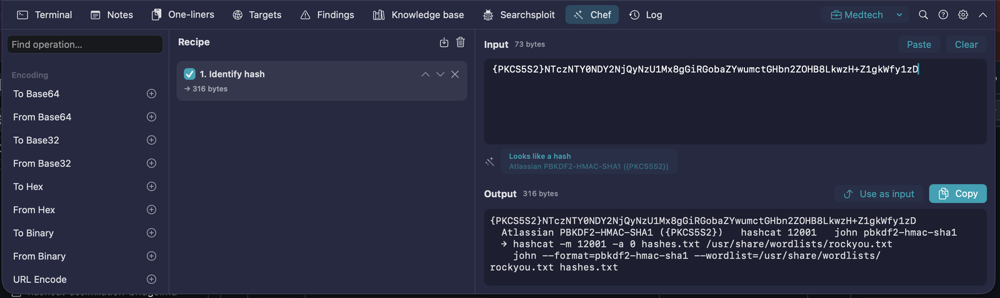
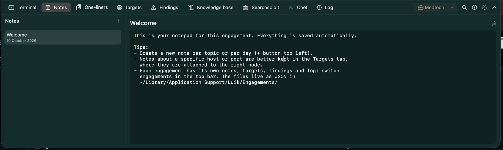

<p align="center">
  
</p>

# Luik

[](https://github.com/mothproof3512/luik/actions/workflows/build.yml)


[](LICENSE)

A Guake-style drop-down app for macOS, built for pentesters: press a hotkey (⌘Esc by default)
and a panel slides down from the top of the screen with nine tabs:

| Tab | What it does |
|---|---|
| **Terminal** | A real terminal (SwiftTerm) with multiple tabs, running your own shell as a login shell |
| **Notes** | Markdown notes per engagement (edit / read, code blocks with a copy button), saved automatically — plus the **Library**: your cheat sheets imported from a folder in one go, and documentation such as PayloadsAllTheThings and InternalAllTheThings downloaded (and updated) from GitHub, all searchable |
| **One-liners** | A list of commands with a **Copy** button; `$RHOST`, `$RPORT`, `$RURL`, `$LHOST` and `$LPORT` are replaced; commands can also be pasted straight into the terminal. Tag a one-liner with service names or ports and it shows up under the matching port in Targets, filled in for that host |
| **Targets** | Import nmap, Nessus, nuclei or masscan output (one host or many IPs at once). One node per system, one node per port, and work-item nodes underneath with status and notes, so you can work systematically; scanner findings become nodes under the port |
| **Findings** | The findings of the engagement with a CVSS 3.1 calculator, affected hosts/services, description/impact/evidence/recommendation/references and status — created by hand, from a target node, from a knowledge-base record or from a Nessus/nuclei import; exported as a Markdown or HTML report |
| **Knowledge base** | Download the attack-vectors knowledge base that comes with Luik (349 rows, English or Dutch) or import your own findings sheet (.xlsx, .csv or .json) — also straight from your own GitHub repository — and search every column instantly: a product name, version string, CVE, CWE or technique; then read the full finding, with links clickable and matches highlighted |
| **Log** | Timestamped activity log: commands pasted from One-liners/Searchsploit, every command you run in Luik's terminal tabs (read from the screen when you press Enter — also inside ssh sessions; passwords never appear on screen, so they are never logged), imports and your own notes — exportable as Markdown for the report |
| **Chef** | CyberChef-style data kitchen: build a recipe of operations (Base64/Base32/hex/URL/HTML/Unicode, hashes and HMAC, JWT decode, gzip/zlib, JSON, regex, extractors for IPs/URLs/emails/hashes/CVEs, defang, CIDR, timestamps) and the output updates as you type; a magic detector suggests decodings |
| **Searchsploit** | Exploit-DB search built in: download the official database once, then search it offline like searchsploit, with version-aware matching (`apache 2.4.49` also finds `< 2.4.50` and `2.4.x` entries). Every hit comes with copy-and-paste command lines for the machine where you want the exploit |

Everything is stored locally as JSON in `~/Library/Application Support/Luik/`.

## Screenshots

Each shot uses a different colour scheme (Settings › Colours); the engagement name sits in the
top bar, the tabs are ⌘1 … ⌘9.

<p align="center">
  
  <br><sub><b>Targets</b> — hosts and ports from an nmap import, checklist nodes with a status, and the Suggestions panel matching the service version against Exploit-DB and the knowledge base.</sub>
</p>

<table>
  <tr>
    <td width="50%"><br><sub><b>Terminal</b> — SwiftTerm tabs running your own login shell; saved connections under Connect.</sub></td>
    <td width="50%"><br><sub><b>One-liners</b> — commands with Copy / paste-into-terminal buttons; <code>$RHOST</code>, <code>$RPORT</code>, <code>$LHOST</code> and <code>$LPORT</code> filled in from the fields at the top; tagged ones also appear under the matching port in Targets.</sub></td>
  </tr>
  <tr>
    <td><br><sub><b>Findings</b> — severity, status, CVSS 3.1 calculator, affected hosts/services and the report sections; this one was created from a Targets node.</sub></td>
    <td><br><sub><b>Knowledge base</b> — your own findings sheet, searchable across every column, with scope / severity / kill-chain-phase filters, Add to target and Create finding.</sub></td>
  </tr>
  <tr>
    <td><br><sub><b>Searchsploit</b> — Exploit-DB offline, with ready-made command lines per hit.</sub></td>
    <td><br><sub><b>Chef</b> — recipes of operations; here <i>Identify hash</i> recognising an Atlassian <code>{PKCS5S2}</code> hash and suggesting the hashcat / john command.</sub></td>
  </tr>
  <tr>
    <td><br><sub><b>Notes</b> — Markdown notes per engagement, saved automatically, with the library of cheat sheets and downloaded documentation in the sidebar.</sub></td>
    <td></td>
  </tr>
</table>

## Installing

### Option 1: build it yourself (recommended)

Requires macOS 14 (Sonoma) or newer and Xcode **or** just the Command Line Tools
(`xcode-select --install`). No other dependencies: SwiftTerm is bundled as source in
`Vendor/`, so the build needs no network access.

```bash
git clone https://github.com/mothproof3512/luik.git
cd Luik
./build.sh --install     # builds build/Luik.app, copies it to /Applications and launches it
```

Build only: `./build.sh` (result in `build/Luik.app`). Launch without installing: `./build.sh --run`.
If you have Xcode, you can also open `Package.swift` in Xcode and build/debug from there.
A locally built app launches without fuss: it is ad-hoc signed and not quarantined.

### Option 2: ready-made download

For every `v*` tag, GitHub Actions builds a `Luik.app.zip` and attaches it to the
[releases](https://github.com/mothproof3512/luik/releases). That app is not notarized (that
requires a paid Apple Developer account), so Gatekeeper blocks it after download. Fix: unzip,
drag `Luik.app` to `/Applications` and remove the quarantine flag once:

```bash
xattr -dr com.apple.quarantine /Applications/Luik.app
```

(Or: System Settings › Privacy & Security › "Open Anyway" after the first attempt.)

Luik has no Dock icon; you find it as a ⌄ icon in the menu bar (show/hide, settings, quit).

## Usage

- **Hotkey**: **⌘ Esc** by default. To change it: gear icon top right › General › click the hotkey
  field › press the key or combination you want (e.g. F12 like Guake, ⌃`, ⌥Space, ⌘⇧T).
  A bare Esc cancels recording, ⌫ clears the hotkey. The list icon next to the field offers a
  few common choices. Letters and digits only work together with ⌃, ⌥ or ⌘, otherwise you could
  never type that key again. If macOS cannot register the combination (because another app
  already owns it), you see that right under the field. If you pick a function key: on a MacBook
  keyboard that is `fn`+F-key, unless "Use F1, F2, etc. keys as standard function keys" is
  enabled (System Settings › Keyboard).
- The panel appears on the screen the mouse is on, 55% high and full width by default. Drag the
  bottom edge to change the height (a grip appears when the mouse is over it; the new height is
  kept as the Height setting), double-click the edge to go back to the default; width and height
  are also sliders in Settings › Appearance.
- **Transparency**: Settings › Appearance › *Background opacity* applies to the whole panel
  (every tab). *Blur* blurs what is behind it (macOS HUD style); turn blur off for full
  transparency like Guake. *Extra terminal opacity* adds a dark layer under the terminal text only.
- **Corners and animation**: Settings › Appearance › *Corner radius* (0 = square) and *Round the
  top corners too*; *Animation* sets how fast the panel slides down (all the way left = instant,
  no animation).
- **Tabs** can be reordered by dragging them in the top bar (or right-click a tab: Move left /
  right, Reset tab order; also View › Reset Tab Order and Settings › Appearance). ⌘1–⌘9 and the
  View menu follow the order you choose; it is remembered.
- By default the panel hides as soon as another app gets focus (can be turned off in settings).
  When hiding, the app you were using before gets focus back.

### Keyboard shortcuts inside the panel

The full list, including mouse tricks and your own hotkey, is one keystroke away in the app:
**⌘/** (or the ? button in the top bar, Help › Keyboard Shortcuts, or ⌘K → "Keyboard shortcuts").

| Keys | Action |
|---|---|
| ⌘1 … ⌘9 | The tabs in the order of the top bar (default: Terminal / Notes / One-liners / Targets / Findings / Knowledge base / Searchsploit / Chef / Log) |
| ⌘T, ⌘W | New / close terminal tab |
| ⌘⇧] , ⌘⇧[ | Next / previous terminal tab |
| ⌘C / ⌘V | Copy / paste (also in the terminal) |
| ⌘K | Search everything |
| ⌘N | New finding |
| ⌘⇧E | Capture evidence screenshot (⌘⌥⇧E keeps Luik visible) |
| ⌘F / ⌘G / ⌘⇧G | Find in the terminal scrollback (and in text fields) |
| ⌘, | Settings |
| ⌘Q | Quit Luik |

### Notes and the library

- Notes are **Markdown**. The control at the top right switches between **Edit** (plain text,
  monospaced) and **Read** (rendered: headings, lists, tables, quotes, links, and code blocks with
  a **copy** button). The choice is remembered. Each engagement has its own notes.
- The **Library** in the sidebar is shared by all engagements and lives as plain `.md` files in
  `~/Library/Application Support/Luik/Library/<collection>/`:
  - **⋯ › Import folder or files…** copies a folder of cheat sheets in one go (subfolders kept; the
    folder name becomes the collection) or loose `.md` files (into "Cheatsheets"). Edit them in Luik
    (saved back to the file) or in any editor — **Rescan** picks up outside changes; **Show in
    Finder** opens the folder.
  - **⋯ › Download documentation…** fetches **PayloadsAllTheThings** and **InternalAllTheThings**
    (swisskyrepo, MIT) or any GitHub repository of Markdown pages you add (`owner/name`, optional
    branch; a token for private repositories, kept in the keychain). Luik downloads the repository
    archive, keeps the Markdown files and remembers the commit; **Check for updates** compares with
    GitHub and **Update** replaces the copy. Links between pages open inside Luik.
  - The filter box searches notes and the whole library (titles first, then full text); ⌘K finds
    library pages too, and a knowledge-base record that names a PayloadsAllTheThings page gets an
    **Open in the library** link once that documentation is downloaded.

### One-liners

- Fill in **$RHOST** (the target), **$RPORT**, **$LHOST** (your own address — the antenna button
  detects it, preferring VPN tunnels such as utun/tun) and **$LPORT**; they are replaced in commands
  when copying or pasting. **$RURL** becomes `http(s)://$RHOST:$RPORT` (https for ssl/https services
  and ports 443/8443, default ports left out). **export** runs `export RHOST=… RPORT=… RURL=…
  LHOST=… LPORT=…` in the active terminal tab so the variables work there too. The older forms
  `<ip>`, `<target>` and `$TARGET` still work.
- **Copy** puts the command on the clipboard; the terminal icon pastes it into the active terminal
  tab (without Enter, so you can still edit it).
- **Steps**: a one-liner can be several commands that belong together — a listener on your
  machine, the payload on the target, the upgrade afterwards. Add steps in the editor (each with an
  optional label such as "On the target"), reorder them with the arrows; the row shows them
  numbered with their own copy / paste buttons and **Copy all** for the whole sequence, also at the
  matching port in Targets.
- **Order**: drag a row to move it within its category (or right-click › Move up / down / to top /
  to bottom); the arrows next to a category heading move whole categories. The order is kept.
- **Reverse shell** (button in the toolbar, Tools menu, ⌘K): a generator that reads the templates
  from the *Reverse Shell Cheat Sheet* in your library — download **InternalAllTheThings** (where
  the sheet lives now; PayloadsAllTheThings only points to it) — plus your own one-liners in a
  category named *Reverse shells*. Pick a template (Bash, Python, PHP, PowerShell, …), fill in
  `$LHOST`/`$LPORT` (shared with the One-liners tab), choose the shell to spawn and an encoding
  (URL, double URL, base64 pipe, PowerShell `-EncodedCommand`); the sheet shows the listener to
  start first (netcat, rlwrap, ncat, socat, pwncat-cs, Metasploit handler), the payload and the TTY
  upgrade from the same cheat sheet, each with Copy (the listener and the upgrade also paste into
  the terminal). **Save as one-liner** keeps the three steps with the placeholders, so they follow
  `$LHOST`/`$LPORT` later. Nothing is bundled: the templates update with the documentation.
- **Show in Targets at** (in the editor): service names and/or port numbers (`http, https, 80, 443`,
  `microsoft-ds, 445`), `host` for every host or `port` for every port. Tagged one-liners appear in
  the **One-liners** panel of the matching host/port in Targets (see below) with the host and port of
  that node filled in. The bundled list is tagged already; the capsule next to the title shows the tags.
- Edit, delete and add in the app; the list lives in `snippets.json`. The bundled list contains
  recon and enumeration commands as a starting point — change it as you like.

### Targets (nmap, Nessus, nuclei, masscan)

1. Click **Import scan** and paste the output, or choose one or more files; the format is detected.
   Supported: nmap normal screen output (`nmap ...` / `-oN`), grepable (`-oG`) and XML (`-oX`);
   Nessus exports (`.nessus`); nuclei JSON (`-json`, `-jsonl`, `-je`); masscan (`-oL`, `-oJ`, `-oG`).
   Tip: scan with `-oA scans/name` and you have all three nmap formats. Large files (Nessus exports)
   are imported straight away instead of being loaded into the text box.
   For Nessus and nuclei you choose from which severity a **node per scanner finding** is added under
   the port (plugin name, severity, synopsis/description/solution/output in the notes) and from which
   severity an entry in the **Findings** tab is created — one per plugin/template with every affected
   host:port, merged into the existing entry when you import again.
2. Every host gets a node (IP + hostname), with underneath:
   - a node per open port (service/version as subtitle, NSE script output in the notes),
   - under every port the **work-item nodes** from the checklist for that service — SMB, HTTP,
     SSH, LDAP, Kerberos, MSSQL, SNMP, RDP and about twenty more have their own; ports with no
     match get the generic list (Enumeration, Versions & CVEs, Misconfigurations, Credentials,
     Exploitation, Notes),
   - under the host itself the system checklist (Recon & enumeration, Vulnerabilities, Initial
     access, Privilege escalation, Post-exploitation & loot).
3. Importing the same host(s) again only adds new ports/information; nothing is duplicated.
4. Every node has a status (click the circle: to do → in progress → done → N/A) and a notes field.
   Hosts and ports show their progress (handled/total). Right-click for sub-nodes, status or delete.
5. The checklists are yours to change (see below). The ⋯ menu exports everything as Markdown.
6. Select a port node and the **Suggestions** panel shows matching Exploit-DB entries (product and
   version taken from the nmap service description, version-aware) and knowledge-base findings;
   one click opens the hit in its own tab.
7. The **One-liners** panel on a host, port or work-item node lists the one-liners tagged for that
   host or service (`http` on 10.10.10.5:8080 → `whatweb -a 3 http://10.10.10.5:8080`, …) — copy, or
   paste into the terminal; **Use … as $RHOST / $RPORT** makes the node the target for the One-liners
   tab, the export button and the saved connections.

### Checklists — your own workflow

**Edit checklists…** (Targets ⋯ menu, Settings › Targets, Tools menu or ⌘K) opens the editor:
on the left **Every system**, **Every port** (the fallback) and one checklist per service; on the
right the list's name, the keys it applies to and its items. Keys are service names as nmap and
Nessus report them (`http`, `ssl/http`, `microsoft-ds`, `ms-sql-s`, …) and/or port numbers; the
first matching list wins, so order matters (drag or use the arrows). Every item becomes a work-item
node with a status; an optional **hint** on an item is written into the node's notes when the node is
created, with `$RHOST`, `$RPORT`, `$RURL` (and `$LHOST`/`$LPORT` from One-liners) filled in — the place for
the commands you always run and the things you always check for that service. A tester at the
bottom shows which list a given service/port would get. Checklists live in `checklists.json` in the
data folder, shared by all engagements. **Export** writes all of them as JSON (for Luik) or Markdown
(for a wiki or repository — importable too), or just the selected list; **Import** reads such a
file and asks whether to merge (same-named lists replaced, others kept) or replace everything, while
a file with single checklists is simply added. Both are also in the Targets ⋯ menu and Settings ›
Targets. **Apply to current targets** adds missing items to the hosts and ports you already have.

### Colour schemes

Settings › Colours offers the Luik default plus ten combinations from Sanzo Wada's *A Dictionary
of Color Combinations* (1933): from each combination the darkest colour becomes the panel tint, the
lightest the terminal text and the most saturated one the accent — buttons, selected tab, cursor
and selection. Opacity and blur from the Appearance tab still apply on top. The colour values come
from Matt DesLauriers' [dictionary-of-colour-combinations](https://github.com/mattdesl/dictionary-of-colour-combinations) dataset (MIT).

### Findings and the report

Every finding has a title, severity, an optional CVSS 3.1 vector (the calculator shows the eight
base metrics as pickers plus temporal metrics; paste a vector from an advisory and press Apply; the
severity follows the score), the affected hosts/services (one per line; **Add** inserts the selected
Targets node), description, impact, evidence (the camera button links a screenshot here),
recommendation, references, a status (open → confirmed → reported → resolved / false positive) and a
source. Findings come from four places: the **+** button, the **Finding** button on a Targets node
(its notes become the evidence, host:port the affected service), **Create finding** on a knowledge-base
record (description/impact/recommendation/references are mapped by column name) and Nessus/nuclei
imports. The ⋯ menu exports the whole set as a **Markdown** or **HTML report** (summary table, then
one section per finding, most severe first); Word opens the HTML directly (File › Open) and
`pandoc findings.html -o findings.docx` makes a .docx.

### Engagements and scope

The briefcase menu in the top bar switches between engagements. Targets, notes, findings, the log and
the evidence screenshots (a subfolder per engagement) are kept apart; one-liners, the knowledge base,
Exploit-DB, Chef recipes and connections are shared. **Manage engagements…** holds client, reference,
period, notes and the **scope**: one entry per line as CIDR (`10.0.0.0/24`), address, range
(`10.0.0.10-10.0.0.20` or `10.0.0.10-20`), hostname (`example.com` covers its subdomains, `*.example.com`
too) or IPv6 prefix, plus exclusions that win over the scope. A **Check** field tells you whether an
address is in scope; hosts outside the scope get an orange shield in Targets and are listed in the
import summary. Existing data from before 0.14 lands in the "Default engagement" automatically.

### Knowledge base

0. **Download** (Knowledge base tab, Tools menu or ⌘K) fetches a ready-made knowledge base from
   this repository: the [attack-vectors knowledge base](knowledge-base/README.md) — 349 attack
   vectors and CVEs across web, API, network, Active Directory, cloud, mobile, wireless, social
   engineering, physical, endpoint and AI/LLM, with default severity, description, impact, test
   approach, remediation and detection note, mapped to OWASP Top 10 2025, WSTG, ASVS 5.0, MITRE
   ATT&CK, CWE, CISA KEV and more — in **English** or **Dutch**. The same sheet takes a link to
   your own file (GitHub, GitLab, a web server; GitHub `…/blob/…` links are converted, an access
   token covers private repositories and is kept in your keychain) or to a *catalogue* of your
   team's knowledge bases; **Settings › Tools › Knowledge base catalogue** makes such a catalogue
   the default list. When the catalogue has a newer version of what you imported, the sheet shows
   **Update**. The format is described in [knowledge-base/README.md](knowledge-base/README.md).
   Prefer your own sheet? The empty tab explains which columns Luik recognises, and **Save example
   template…** (also in the ⋯ menu, the ? button, Help menu and ⌘K) writes a CSV with those columns
   (`id, title, scope, severity, cvss_vector, kill_chain_phase, description, impact, recommendation,
   references, how_to_test, tags`) and two example rows: open it in Excel or Numbers, replace the
   examples, save as .xlsx or .csv and import it.
1. Click **Import** and choose your findings sheet: an Excel file (`.xlsx`), CSV/TSV or JSON. Every
   sheet in the workbook becomes a searchable table; the header is the first row with at least two
   filled cells, so a title row above the real header is fine. No third-party code is involved: the
   .xlsx is unpacked with the system's `unzip` and read with Foundation's XML parser.
2. Type in the search field: every term must occur somewhere in the row (any column); use
   `"quotes"` for a phrase. Hits in the ID or title column rank first. Columns named like
   *Scope*/*Category*, *Severity*/*CVSS* and *Kill chain phase*/*Tactic* become filter menus
   automatically (phases are listed in attack order).
3. Select a hit to read the whole finding: every non-empty column, search terms highlighted, URLs
   clickable. **Copy as Markdown** puts it on the clipboard; **Add to target** appends it to the
   notes of the node currently selected in the Targets tab.
4. A re-import replaces the previous copy; **Remove knowledge base** (⋯ menu) deletes Luik's copy.
   The imported data lives only in `~/Library/Application Support/Luik/knowledgebase.json` — the
   app itself contains no knowledge base, and nothing but the download request leaves the Mac.

### Searchsploit

1. Click **Download** once: Luik fetches Exploit-DB's own `files_exploits.csv` (about 10 MB, the
   file searchsploit searches) from the official GitLab repository and keeps it in its data folder.
   No network is needed afterwards; click **Update** whenever you want the latest entries. Without
   internet access, import the file from a local searchsploit installation instead (⋯ menu; a
   Homebrew/Kali copy is detected automatically).
2. Search like you would with searchsploit: all terms must match (title, platform, type, CVE codes,
   tags, path), `"quotes"` keep a phrase together, `CVE-…` works too. Version-like terms are matched
   smartly: `apache 2.4.49` finds exact mentions first, then ranges such as `< 2.4.50`,
   `2.4.0 - 2.4.49` or `2.4.49 and prior`, then families such as `2.4.x` or `2.4`.
3. Filter on platform and type, show verified entries only, hide DoS entries, and sort by relevance
   or date.
4. Select a hit for the command lines, each with a Copy button (or **Copy all commands**):
   `searchsploit -m/-x/-p <id>`, the Kali path, `wget`/`curl` downloads of the exact file from
   GitLab or exploit-db.com, a run/compile hint based on the file type, and a one-liner to serve the
   file to another machine. The terminal icon pastes a command into Luik's own terminal.

### Search everything (⌘K)

One box over notes, one-liners, targets (hosts, ports, work items), findings, knowledge-base records,
Exploit-DB, Chef operations, the log, engagements ("Switch to …") and actions such as "Go to Targets",
"New finding" or "New terminal tab".
↑↓ to choose, ↩ to open the hit in its own tab, esc to close.

### Evidence screenshots (⌘⇧E)

Runs macOS's own `screencapture -i`: drag an area, or press space and click a window. The PNG is
saved with a timestamp in `~/Documents/Luik Evidence` (Settings › Tools), a Markdown image link is
appended to the notes of the selected target node, and the capture is written to the Log. By default
Luik hides itself first so you can capture what is behind it; ⌘⌥⇧E keeps it visible. macOS asks once
for Screen Recording permission.

### Terminal connections

The **Connect** menu in the terminal tab bar holds saved connections (ssh with a jump host, a
Kali box, …): each is a command that opens in a new tab, with `$RHOST`/`$LHOST`/`$LPORT` filled in.
⌘F opens SwiftTerm's find bar to search the scrollback.

### Log

Everything that happens during an engagement, with a timestamp: commands pasted into the terminal
from One-liners or Searchsploit, every command you run in Luik's terminal tabs, scanner and
knowledge-base imports, findings added to targets, evidence screenshots and notes you add yourself.
Filter by kind, search, copy or export as Markdown grouped per day.

Typed commands are taken from the screen at the moment you press Enter: the text on the cursor row
after the prompt. That makes it work in every shell and interactive program (zsh/bash line editors,
ssh sessions on other machines, msfconsole, python…), with tab completion and commands recalled from
history, and it is what keeps passwords out of the log: whatever you type at a prompt that does not
echo (sudo, ssh, su, `mysql -p`, `read -s`, also on the remote side) never appears on screen and is
never recorded. Full-screen programs (vim, less, htop, tmux) use the alternate screen and are
ignored. The feature can be turned off under Settings › Terminal.

### Chef

Operations on the left, the recipe in the middle, input and output on the right — the output is
recalculated on every change. Click an operation to add it as a step; steps have parameters
(delimiter, key, shift, regex, …), can be disabled, reordered or removed, and show the byte count
or the error after each step. Paste something unknown and the magic bar suggests what it looks
like (Base64, hex, URL-encoded, JWT, JSON, Unix time, …) — one click adds the decoder. **Use as
input** feeds the output back in for the next round; recipes can be saved by name. Everything runs
locally; nothing is sent anywhere.

**Identify hash** (one hash or hash-bearing line per input line) names the likely algorithms with
the hashcat mode and john format, splits them into *likely* and *less likely*, and ends with a
ready-made `hashcat -m … / john --format=…` line. It understands more than bare digests: `hash:salt`
pairs (with the vBulletin/MyBB/Joomla/osCommerce salt lengths), `user:hash` and /etc/shadow lines,
pwdump/secretsdump lines (NT in field 4, LM in field 3, empty-password and disabled-LM hashes
pointed out), NetNTLMv1/v2 captures and Responder log lines, Kerberos (TGS-REP, AS-REP, pre-auth
for etypes 17/18/23), DCC2, Unix crypt (descrypt, bsdicrypt, md5crypt, bcrypt, sha256/sha512crypt,
yescrypt, Argon2, sunmd5, sha1crypt), PBKDF2 and scrypt notations, Django/phpass/Drupal/WordPress,
LDAP `{SSHA}`-style and AIX hashes, MySQL/PostgreSQL/MSSQL/Oracle/Sybase, Cisco (types 4/5/7/8/9,
ASA/PIX, whole `enable secret`/`password 7` configuration lines), Juniper `$9$`, FortiGate, Office,
PDF, ZIP/RAR/7z, KeePass, GPG, SSH keys, BitLocker, wallets, WPA, JWTs, Base64 digests, `0x`
prefixes, checksum lines and colon-separated fingerprints. **Cisco type 7 decode** and **Juniper $9$
decode** reverse those two obfuscations (the magic bar spots them too).

## Project layout

```
Package.swift              SwiftPM manifest (macOS 14+, Swift 5.9+)
build.sh                   builds and bundles Luik.app (signs with "Luik Local" when present)
scripts/make-signing-identity.sh  one-time local signing certificate, so macOS permissions survive rebuilds
Sources/Luik/
  main.swift               starts NSApplication
  AppDelegate.swift        menu bar item, main menu, hotkey, wiring of all modules
  HotKey.swift             global hotkey (Carbon RegisterEventHotKey, no extra permissions needed)
  HotKeyRecorder.swift     recorder field for choosing your own hotkey
  DropdownPanel.swift      the sliding panel (position, animation, handing focus back)
  RootView.swift           tab bar + settings
  Settings.swift           keys and defaults
  Storage.swift            JSON storage + autosave
  Terminal/                SwiftTerm sessions and tabs
  Notes/                   Markdown notes, renderer (MarkdownView) and the library sidebar
  Library/                 library store (collections of .md files), GitHub downloads and the sources sheet
  Snippets/                one-liners (multi-step, ordering, $RHOST/$RPORT/$RURL/$LHOST/$LPORT)
  Shells/                  reverse shell generator (templates read from the library's cheat sheet)
  Targets/                 nmap/Nessus/nuclei/masscan parsers, tree model, import/export and UI
  KnowledgeBase/           xlsx/csv/json import, search index, catalogue download and UI
  Exploits/                Exploit-DB (searchsploit) database, smart search and commands
  Chef/                    CyberChef-style operations, recipe engine, hash identifier and UI
  Findings/                finding model, CVSS 3.1 calculator, store with report export, UI
  Engagements/             engagement store (per-engagement files, scope matcher) and manager UI
  Activity/                activity log store, typed-command capture and UI
  Palette/                 ⌘K search over everything
  Evidence/                screenshot evidence via screencapture
  UpdateCheck.swift        GitHub release check
Vendor/SwiftTerm/          SwiftTerm 1.11.2 (MIT) as source
Resources/AppIcon.iconset  app icon
knowledge-base/            downloadable knowledge bases (EN/NL) and the catalog.json the app reads
```

### Remote desktops and VMs (Windows App, Microsoft Remote Desktop, Parallels, VMware)

Luik's hotkey is system-wide: while it is registered, that key never reaches a remote desktop or
VM. If you want ⌘Esc (or whatever you chose) passed through there, enter the app's name under
Settings › General › **Pause hotkey in** (e.g. `Windows App, Remote Desktop`). While that app is
active the hotkey is paused; open Luik from the menu bar icon in the meantime. As soon as you
switch to another app the hotkey works again.

When hiding, Luik hands focus back to the app that was active before (macOS 14 "cooperative
activation"). If that fails, Luik withdraws itself so macOS activates the next app; otherwise that
app would get mouse input but no keyboard input.

## Troubleshooting

- **The hotkey does nothing**: macOS or another app probably owns the combination (for function
  keys: `fn`). Pick another hotkey via the menu bar icon › Settings.
- **Keyboard stops working in a remote desktop (mouse works)**: quit Luik for a moment (menu bar
  icon › Quit Luik). If it works again, add the remote desktop app's name under "Pause hotkey in"
  and use version 0.2 or newer (better focus hand-back). If it is also broken without Luik, look
  at "Secure Keyboard Entry" (Terminal/iTerm2 menu): with that enabled, remote desktop clients on
  macOS often get no keyboard input at all.
- **The panel does not appear over a full-screen app**: Luik uses a floating panel that is allowed
  over full-screen apps; if that fails, switch Spaces briefly.
- **macOS keeps asking for Screen Recording (evidence screenshots) although you granted it**: the
  permission is tied to the app's code signature, and an ad-hoc signature changes with every
  rebuild, so each `./build.sh --install` looks like a new app to macOS. Run
  `./scripts/make-signing-identity.sh` once: it creates a local "Luik Local" certificate that
  `build.sh` then uses, so the identity stays the same across builds. Rebuild, and in System
  Settings › Privacy & Security › Screen Recording remove the old Luik entry (−) and grant it once
  more. On macOS 15 a monthly "continue to allow" confirmation is normal for every screen-recording
  app. Downloads from the Releases page are ad-hoc signed and keep the old behaviour.
- **Build errors**: the code targets Swift 5.9+ and macOS 14+. Open an issue with the error message.
- **Starting over**: quit Luik and delete (or rename) `~/Library/Application Support/Luik/`.

## License

Luik is available under the [MIT License](LICENSE).

Luik bundles [SwiftTerm](https://github.com/migueldeicaza/SwiftTerm) by Miguel de Icaza (version
1.11.2, MIT License, with two small Luik-specific additions marked in the source) as source in
`Vendor/SwiftTerm/`; its license is in `Vendor/SwiftTerm/LICENSE`. The colour schemes use values
from the [dictionary-of-colour-combinations](https://github.com/mattdesl/dictionary-of-colour-combinations)
dataset by Matt DesLauriers (MIT License), digitised from Sanzo Wada's 1933 book.
